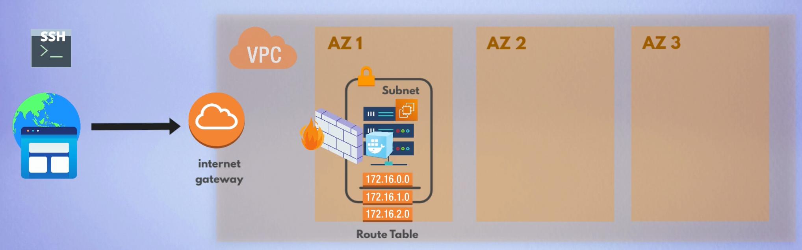
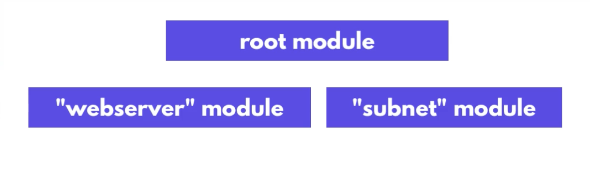
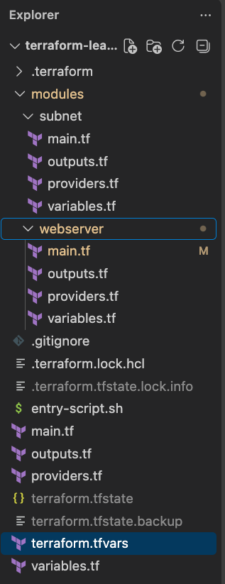

# Automate AWS Infrastructure

**Terraform code that builds a complete AWS environment, from network to a running Docker container, with one command.**

**Technologies:** Terraform, AWS, Docker, Linux, Git

In this project I used Terraform to automate provisioning of AWS infrastructure and its components:

- VPC
- Subnet
- Route table
- Internet gateway
- EC2 instance
- Security group

I also configured a Terraform script to automate deploying a Docker container to the EC2 instance. When the server boots, it installs Docker and starts the container automatically, so no manual server setup is needed.

_Architecture: VPC, subnet, route table and security group behind an internet gateway._

 

_Terraform creating the VPC and subnet._

 

_The VPC in the AWS console._

 

_The subnet inside the VPC._

 

_The internet gateway attached to the VPC._

 

_The route table sending traffic to the internet gateway._

 

_The security group with SSH and port 8080 rules._

 

_Terraform creating the EC2 instance._

 

_The EC2 instance running with all status checks passed._

 

_nginx container running on the server, started by the entry script._

 

_The app live on the server's public IP._

## Modularize Project

In this project I divided the Terraform resources into reusable modules. Instead of keeping everything in a single `main.tf`, the code is split into a root module and two child modules, which makes it easier to reuse, read and maintain. The modular version is on the [`feature/modules`](../../tree/feature/modules) branch.

- **Root module:** creates the VPC, calls the child modules and passes in the values from `terraform.tfvars`
- **`subnet` module:** subnet, internet gateway and route table
- **`webserver` module:** security group, AMI lookup, SSH key pair and EC2 instance

Each module has its own `main.tf`, `variables.tf`, `outputs.tf` and `providers.tf`, so it is a self-contained building block with clear inputs and outputs.

**How the modules connect:**

- The root module passes the VPC ID into both modules
- The `subnet` module outputs the subnet, and the root module passes its ID into the `webserver` module
- The `webserver` module outputs the instance, and the root module prints its public IP

**Why it matters:**

- The same module can be reused for other environments or servers by changing only the variables
- Each file has one responsibility, which makes the code easier to read and review
- Changing the server does not touch the network code, and the reverse

_Module structure: the root module calls the `webserver` and `subnet` modules._

 

_Folder structure: each child module lives in its own folder under `modules/`._
