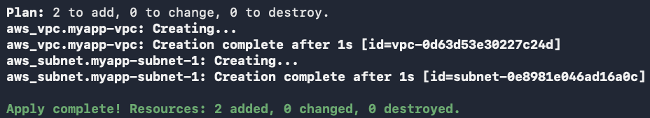
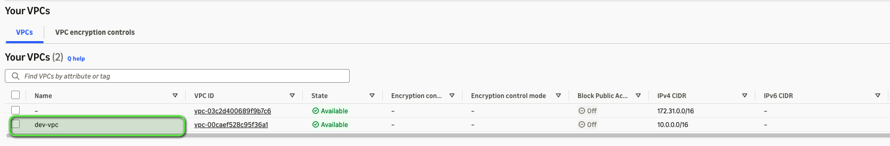
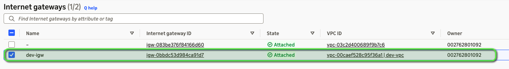
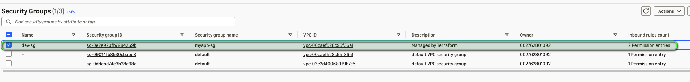
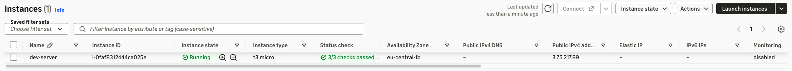
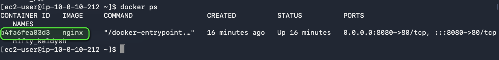
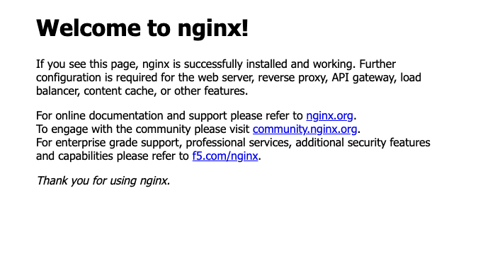

# Demo Project: Automate AWS Infrastructure

**A Terraform project that builds a complete AWS environment (network, firewall, server and a running Docker container) from code with a single `terraform apply`, and removes it again with `terraform destroy`.**

> **Scenario:** A team sets up its servers by clicking through the AWS console. Every environment ends up slightly different, nobody remembers which settings were changed, and rebuilding a server after a mistake takes hours of guesswork.

## Why I built it: the problem this solves

Infrastructure that is built by hand is slow to create, hard to repeat and impossible to review. If the person who clicked it together leaves, the knowledge leaves with them. And when something breaks, there is no record of what the setup is supposed to look like.

This project replaces that with **Infrastructure as Code**. The whole environment, from the VPC down to the Docker container running on the server, is described in Terraform files that live in Git. The same code creates the same environment every time, changes are visible in a diff before they are applied, and the whole setup can be torn down and rebuilt on demand.

## Impact at a glance

- **One command from nothing to a running app.** `terraform apply` creates the VPC, subnet, internet gateway, routing, firewall, SSH key, EC2 instance and an nginx container reachable on a public IP.
- **No manual server setup.** Docker is installed and the container is started automatically when the server boots.
- **Repeatable and disposable.** The environment can be destroyed and recreated identically, so it only costs money while it is actually in use.
- **Always on the latest OS image.** The server image is looked up at apply time instead of being hardcoded, so new servers get the latest patched Amazon Linux 2023 release.
- **Locked down by default.** SSH is only open to my own IP address, and only the application port is open to the internet.
- **Free tier friendly.** Runs on a `t3.micro` instance with an 8 GB disk.

## Skills at a glance

| Skill area | What I did |
| --- | --- |
| **Infrastructure as Code** | Defined the whole environment in Terraform with resources, data sources, variables and outputs |
| **AWS networking** | Built a VPC, subnet, internet gateway and route table so the server can reach and be reached from the internet |
| **Security** | Security group with SSH restricted to my IP, SSH key pair created from my local public key, variable files kept out of Git |
| **Compute** | Provisioned an EC2 instance from a dynamically selected Amazon Linux 2023 AMI |
| **Server automation** | Used `user_data` with an entry script to install Docker and start an nginx container on first boot |
| **Configuration** | Kept environment-specific values (CIDR blocks, availability zone, instance type, env prefix) in `terraform.tfvars` instead of hardcoding them |

## What I built

**Technologies:** Terraform, AWS, Docker, Linux, Git

- Created a **VPC** (`10.0.0.0/16`) as an isolated network for the application
- Created a **Subnet** (`10.0.10.0/24`) inside the VPC in availability zone `eu-central-1b`
- Created an **Internet Gateway** and attached it to the VPC
- Configured a **Route Table** that sends all outbound traffic (`0.0.0.0/0`) through the Internet Gateway
- Configured a **Security Group** that allows SSH (port 22) only from my own IP and opens port 8080 for the application
- Used a **data source** to look up the latest Amazon Linux 2023 AMI instead of hardcoding an image ID
- Created an **SSH key pair** in AWS from my local public key
- Provisioned an **EC2 instance** (`t3.micro`) in the subnet with a public IP, and output that IP from Terraform
- Automated deploying a **Docker container** to the EC2 instance: a `user_data` entry script (`entry-script.sh`) installs and starts Docker and runs nginx on port 8080

## Why this approach

- **Terraform instead of clicking in the console:** the setup is written down, versioned in Git and can be reviewed with `terraform plan` before anything changes.
- **Using the VPC's default route table and security group:** I started by creating a separate route table and security group (shown in the screenshots), then switched to configuring the defaults that AWS creates with every VPC. This gives the same result with fewer resources and no unused leftovers.
- **AMI data source instead of a hardcoded image ID:** AMI IDs differ per region and change with every release. Looking up the image by name means the code works in any region and always gets the latest patched image.
- **`user_data` entry script instead of configuring the server by hand:** the server is ready to serve traffic as soon as it boots, and the setup steps are stored in the repo next to the infrastructure. `user_data_replace_on_change` makes sure a changed script results in a fresh server instead of being silently ignored.

## Trade-offs I accepted

- **Local state file:** Terraform state is stored on my machine. That is fine for a solo project, but a team would need shared remote state.
- **One availability zone:** everything runs in `eu-central-1b`. If that zone has an outage, the app goes down with it.
- **Plain HTTP on port 8080:** the app is exposed directly on the instance with no load balancer or HTTPS.
- **Replacing the server on script changes:** with `user_data_replace_on_change`, any change to the entry script destroys and recreates the instance, which also gives it a new public IP.

## Challenges I hit

- **The AMI filter picked the wrong operating system.** My first name filter (`amzn2-ami-kernel-*`) matched Amazon Linux 2, not Amazon Linux 2023. When I fixed it, I found that each Amazon Linux 2023 release is published with several kernel versions (6.1, 6.12 and 6.18) that all have the exact same creation time. That means `most_recent = true` can't tell them apart, so I pinned the filter to the 6.18 kernel to get a predictable result.
- **Indentation in the `user_data` script.** With a normal `<<EOF` heredoc, the indentation becomes part of the script, so `#!/bin/bash` is no longer at the very start of the file. AWS then doesn't recognise it as a script and skips it without an error. I moved the script into its own file, `entry-script.sh`, which avoids the problem and is easier to read and edit.

## What I learned

- **Networking is the bulk of the work.** The EC2 instance itself is a few lines. Most of the code is the VPC, subnet, gateway, routing and firewall that make it reachable.
- **Terraform works out the order for me.** Because resources reference each other (`aws_vpc.myapp-vpc.id`, `aws_internet_gateway.myapp-igw.id`), Terraform knows to create the VPC before the subnet and the gateway before the route.
- **Data sources keep code portable.** Looking up values like the AMI at apply time means the code isn't tied to one region or one point in time.
- **`user_data` only runs on first boot.** Changing the script does nothing to a running server unless the instance is replaced, which is why `user_data_replace_on_change` matters.
- **Free tier depends on the instance type, not the image.** The AMI is free, but the instance type decides whether the server is free tier eligible.

## What I'd do differently

- **Store the state remotely** in an S3 bucket with state locking, so a team can work on the same infrastructure safely.
- **Split the code into modules** (network and server) with separate `variables.tf` and `outputs.tf`, and give every variable a type and description.
- **Make the container survive a reboot** by enabling the Docker service (`systemctl enable docker`) and running the container detached with a restart policy (`docker run -d --restart unless-stopped`).
- **Put a load balancer with HTTPS in front of the app** and spread it across several availability zones.
- **Replace SSH with AWS Systems Manager Session Manager**, so port 22 doesn't need to be open at all.

## How to run it

1. Create a `terraform.tfvars` file with your own values:

   ```hcl
   vpc_cidr_block      = "10.0.0.0/16"
   subnet_cidr_block   = "10.0.10.0/24"
   avail_zone          = "eu-central-1b"
   env_prefix          = "dev"
   my_ip               = "<your-ip>/32"
   instance_type       = "t3.micro"
   public_key_location = "~/.ssh/id_ed25519.pub"
   ```

2. Create the infrastructure:

   ```bash
   terraform init
   terraform apply
   ```

3. Open `http://<ec2_public_ip>:8080` in a browser (Docker needs a minute or two to install after the server boots), or connect with SSH:

   ```bash
   ssh -i ~/.ssh/id_ed25519 ec2-user@$(terraform output -raw ec2_public_ip)
   ```

4. Remove everything again:

   ```bash
   terraform destroy
   ```

## Screenshots


_Architecture overview: a VPC with a subnet, route table and security group, reachable from the internet through an Internet Gateway._

<br>


_Terraform creating the VPC and subnet with `terraform apply`._

<br>


_The `dev-vpc` VPC with CIDR block 10.0.0.0/16 in the AWS console._

<br>


_The `dev-subnet-1` subnet created inside `dev-vpc`._

<br>


_The `dev-igw` Internet Gateway attached to `dev-vpc`._

<br>


_The `dev-rtb` route table that routes traffic from the VPC to the Internet Gateway._

<br>


_The `dev-sg` security group managed by Terraform with two inbound rules (SSH and port 8080)._

<br>


_Terraform creating the EC2 instance from the latest Amazon Linux 2023 AMI._

<br>


_The `dev-server` EC2 instance (t3.micro) running in eu-central-1b with a public IP and all status checks passed._

<br>


_SSH into the EC2 instance: `docker ps` shows the nginx container started by the entry script, mapped from port 8080 to 80._

<br>


_The nginx welcome page opened in the browser on the EC2 instance's public IP at port 8080._
