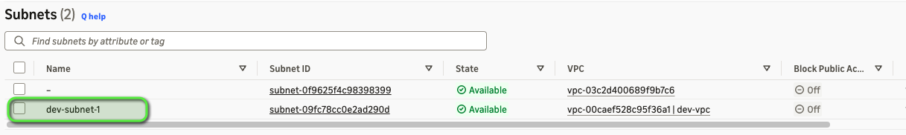
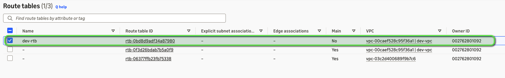
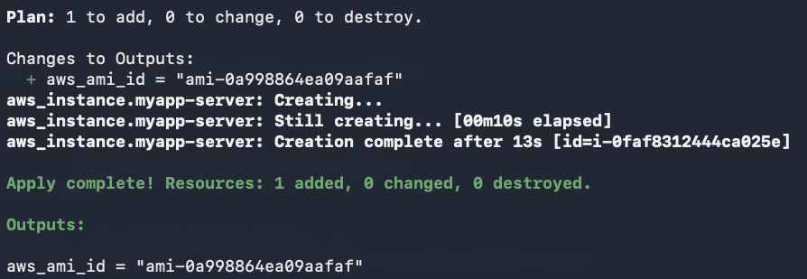

# Demo Project: Automate AWS Infrastructure

**Technologies used:** Terraform, AWS, Docker, Linux, Git

## Project Description

In this project I created a Terraform project that automates provisioning of AWS infrastructure. Instead of clicking through the AWS console, the whole setup is defined as code and created with `terraform apply`.

What I did:

- Created a **VPC** (`10.0.0.0/16`) as an isolated network for the application
- Created a **Subnet** (`10.0.10.0/24`) inside the VPC in availability zone `eu-central-1b`
- Created an **Internet Gateway** and attached it to the VPC so the subnet can reach the internet
- Configured a **Route Table** that sends all outbound traffic (`0.0.0.0/0`) through the Internet Gateway
- Configured a **Security Group** that allows SSH (port 22) only from my own IP and opens port 8080 for the application
- Used a **data source** to always look up the latest Amazon Linux 2023 AMI instead of hardcoding an image ID
- Created an **SSH key pair** from my local public key so I can connect to the server
- Provisioned an **EC2 instance** (`t3.micro`) in the subnet with a public IP, and output that IP from Terraform
- Used variables and a `terraform.tfvars` file so values like CIDR blocks, environment prefix and instance type are not hardcoded

 

*Architecture overview: a VPC with a subnet, route table and security group, reachable from the internet through an Internet Gateway*

 

*Terraform creating the VPC and subnet with `terraform apply`*

 

*The `dev-vpc` VPC with CIDR block 10.0.0.0/16 in the AWS console*

 

*The `dev-subnet-1` subnet created inside `dev-vpc`*

 

*The `dev-igw` Internet Gateway attached to `dev-vpc`*

 

*The `dev-rtb` route table that routes traffic from the VPC to the Internet Gateway*

 

*The `dev-sg` security group managed by Terraform with two inbound rules (SSH and port 8080)*

 

*Terraform creating the EC2 instance from the latest Amazon Linux 2023 AMI*

 

*The `dev-server` EC2 instance (t3.micro) running in eu-central-1b with a public IP and all status checks passed*
